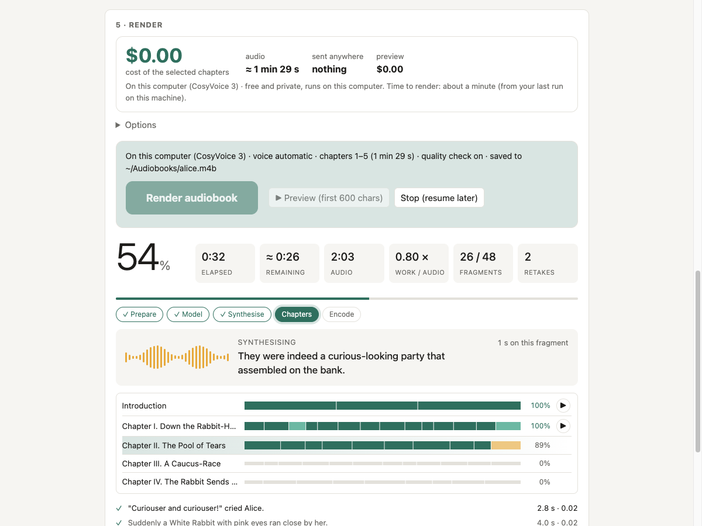
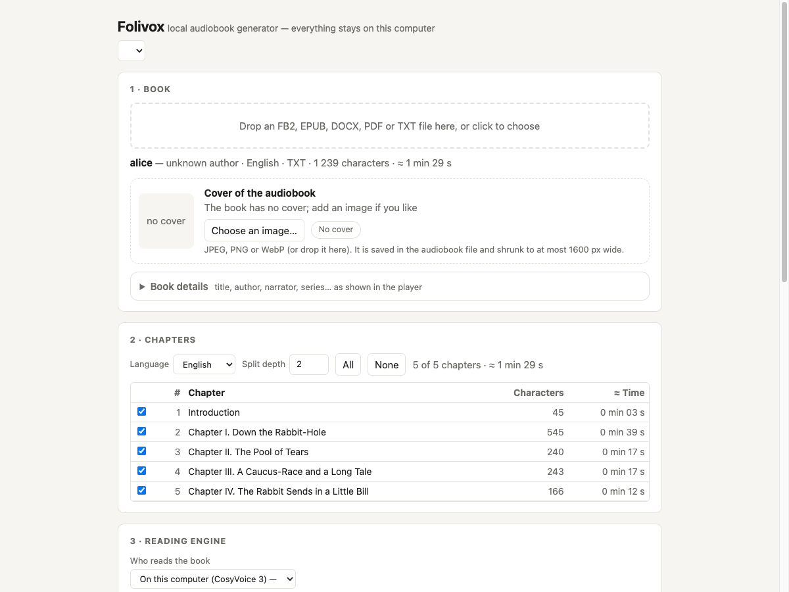
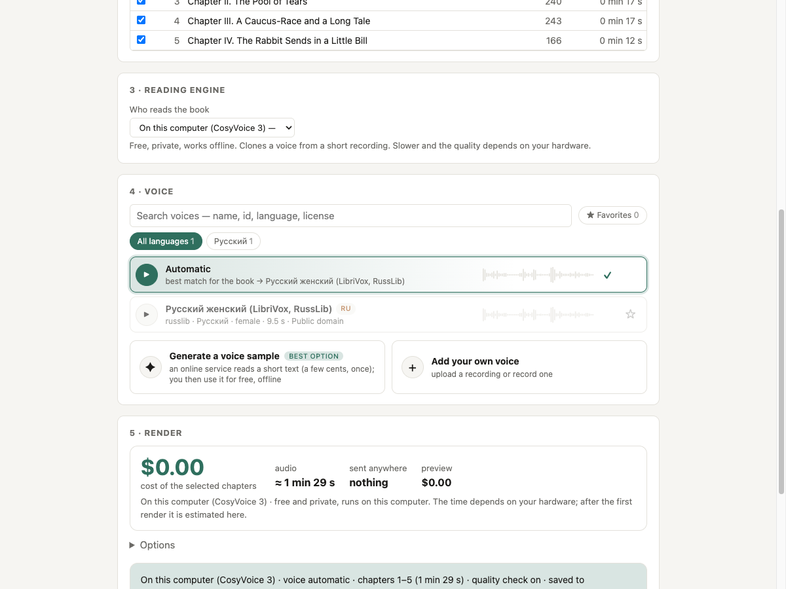
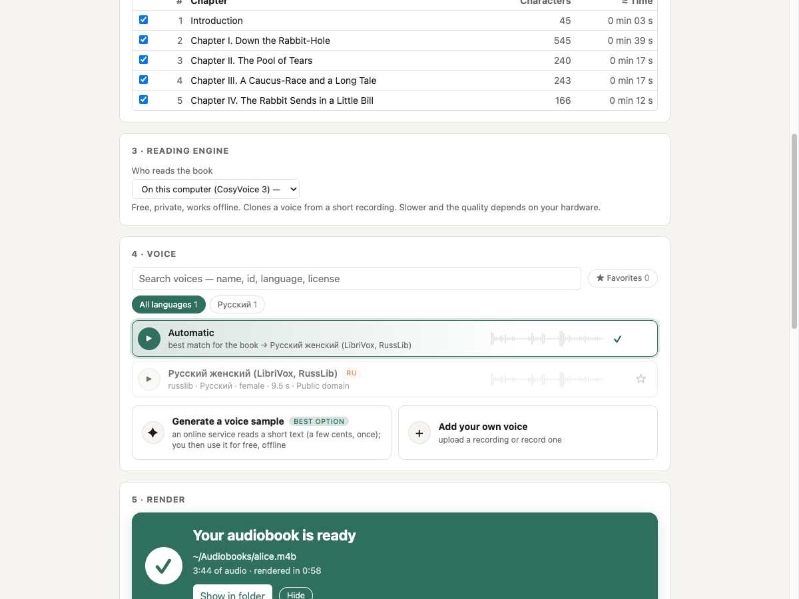

<div align="center">

# Folivox

**Turn any e-book into a chaptered audiobook, read in your own voice. Free, offline, on your computer.**

FB2 · EPUB · DOCX · PDF · TXT &nbsp;→&nbsp; `.m4b` / `.mp3` with chapters, cover and metadata




</div>

## What is this

Folivox reads a whole book aloud with [CosyVoice 3](https://github.com/FunAudioLLM/CosyVoice), an open
model that clones a voice from a 6–15 second sample. It runs on your machine: no account, no subscription,
no per-character fee, and with the local engine nothing leaves your computer. It is built for **long books**
(many hours of audio): every fragment is saved, a crash or a power cut loses nothing, and editing the text
re-reads only what changed.

You can drive it from a **web studio** (`folivox ui`) or from the **command line**.

## Quick start

```bash
git clone <this repository> && cd folivox
./scripts/install.sh            # Windows: powershell -ExecutionPolicy Bypass -File scripts\install.ps1
folivox ui                      # the studio opens in your browser
folivox render book.fb2         # or: no browser, the audiobook appears next to the book
```

The installer sets up `uv`, ffmpeg, the right PyTorch build and Folivox, then runs `folivox setup`, which
checks your machine and downloads the models once (about 6 GB for the voice and 1.6 GB for the quality
check). Details, manual install and troubleshooting: [docs/install.md](docs/install.md).

## Features

<table>
<tr>
<td width="33%" valign="top">

**Many formats in**<br>
FB2 (also `.fb2.zip`), EPUB, DOCX, PDF (text layer, no OCR) and TXT. Chapters, nested sections, poems and
epigraphs are kept; PDF headers, footers and page numbers are removed and hyphenation is undone.

</td>
<td width="33%" valign="top">

**9 languages**<br>
Russian, English, German, French, Spanish, Italian, Chinese, Japanese, Korean. The language comes from the
book's metadata or is detected from the text; `--lang` overrides it.

</td>
<td width="33%" valign="top">

**Your own voice**<br>
Zero-shot cloning from a short clean recording (upload or record in the studio). Optional gentle noise
reduction. A bundled public-domain Russian voice works out of the box.

</td>
</tr>
<tr>
<td valign="top">

**Quality control**<br>
Every fragment is re-transcribed with Whisper. If it does not match the text, it is re-synthesised and the
best take is kept (`--takes`, default 3).

</td>
<td valign="top">

**Text normalisation**<br>
Numbers, dates, years, centuries, units and abbreviations spoken in full (with case and gender agreement
for Russian), `ё` restored, optional stress marks, natural pauses in dialogue.

</td>
<td valign="top">

**Real audiobook files**<br>
One `.m4b` with chapter markers, cover and metadata (title, author, narrator, year, description, series as
the Grouping tag), or one `.mp3` per chapter. Loudness-normalised (−18 LUFS).

</td>
</tr>
<tr>
<td valign="top">

**Built for 10-hour books**<br>
Journal of finished fragments; stop and run again to continue. Edit the text and only changed fragments are
redone. Damaged files after a crash are detected and redone; the old result is never replaced until the new
one is fully written.

</td>
<td valign="top">

**Web studio**<br>
Book, chapters, voice gallery with audition, preview, live progress per chapter and fragment, remaining-time
forecast, playback of finished chapters, stop and resume. Local only, token-protected.

</td>
<td valign="top">

**Online engines, optional**<br>
ElevenLabs, OpenAI, Gemini and Cartesia can read a book or generate a voice sample. Cost estimate first,
explicit confirmation, a spending cap (`--max-cost`) that stops cleanly and resumes.

</td>
</tr>
<tr>
<td valign="top">

**Pluggable**<br>
Speech synthesis, recognition, voice generation and the text LLM are small provider interfaces; swap them
by name or register your own via entry points.

</td>
<td valign="top">

**Hardware aware**<br>
Apple Silicon (hybrid CPU + GPU), NVIDIA CUDA or plain CPU. `folivox doctor` checks ffmpeg, models, disk and
your hardware and gives advice; a GPU failure falls back to the CPU.

</td>
<td valign="top">

**Sturdy**<br>
Early checks for ffmpeg and disk space, resumable model downloads, retries with backoff, a pause through
network outages, a timeout for a stuck fragment, a rotating log and a redacted support bundle.

</td>
</tr>
</table>

### A closer look

<table>
<tr>
<td width="50%"><br><sub>A book loaded: chapters, language, cover and metadata, estimated length.</sub></td>
<td width="50%"><br><sub>Reading engine and voice gallery; add your own voice or generate one.</sub></td>
</tr>
<tr>
<td colspan="2"><br><sub>Done: the card shows the output file, audio length and render time.</sub></td>
</tr>
</table>

<sub>The screenshots show the studio on a short public-domain text (<i>Alice's Adventures in Wonderland</i>).
To keep the capture quick and independent of the model weights, the render in them was simulated with the
same events the real pipeline emits (the test suite's fake render approach); no audio was produced.</sub>

## Why Folivox

- **Free and private.** The default engine is a local open model. No text is uploaded, there is no usage bill.
- **Your voice, any book.** A short sample is enough; the same voice stays consistent through the whole book.
- **Made for long audiobooks, not for clips.** Resumable, crash-safe, with a time forecast and a quality
  check that retakes bad fragments for you.
- **Honest about what leaves your computer.** Online engines are opt-in, labelled, estimated and capped.
- **Open and replaceable.** Apache-2.0, small provider interfaces, no lock-in to one model.

## Usage in short

```bash
folivox inspect book.epub                     # chapter tree, size, estimated duration
folivox book.fb2 -v me.wav -o book.m4b        # render the whole book with your voice
folivox book.fb2 -c 1-2 --preview 600         # a quick test: chapters 1–2, first 600 characters each
folivox book.pdf --mp3 -o out/                # one mp3 per chapter
folivox voices                                # bundled and your own voices
folivox doctor --bundle                       # check the setup / write a redacted support bundle
```

`folivox --help`, `folivox render --help` and `folivox help <topic>` (`voices`, `providers`, `config`,
`languages`, `resuming`, `quality`) explain every option. The full list: [docs/cli.md](docs/cli.md).

## FAQ

**What hardware do I need?** Python 3.10–3.12, ffmpeg and room for the models (about 7.6 GB). macOS on Apple
Silicon, Windows or Linux with an NVIDIA GPU (CUDA) or just a CPU. The CPU works but is slower; `folivox setup`
and `folivox doctor` look at your machine and tell you what to expect.

**How long does a book take?** It depends on your hardware, so we do not quote a number. `folivox inspect`
and the studio show the length of the audio before you start; after the first render on a machine the studio
estimates the time from your own measured speed, and shows the remaining time while it works. Try
`--preview` first to hear a voice on a few hundred characters.

**Is my book uploaded anywhere?** Not with the local engine (the default): everything runs on your computer
and the studio listens on `127.0.0.1` only. Downloading the model weights is the only network use. The online
engines (ElevenLabs, OpenAI, Gemini, Cartesia), online voice generation and an OpenAI-compatible recognition
or LLM provider **do send text (or audio) to that provider and may cost money**; Folivox says so and asks
for confirmation. API keys come from environment variables or your OS keychain, never from a config file.

**Can I stop and continue?** Yes, at any time, even after a crash or a power cut: run the same command (or
press Render) again.

**Whose voice may I clone?** Your own, or one you have explicit permission to use. Folivox ships no celebrity
or third-party voices and has no feature for imitating real people.

**Which voices come with it?** One public-domain Russian voice (`russlib`, LibriVox). For other languages,
add your own sample or generate one; see [docs/voices.md](docs/voices.md).

## Documentation

| Page | What is in it |
|---|---|
| [docs/install.md](docs/install.md) | One-command install, starting the studio, update and removal |
| [docs/cli.md](docs/cli.md) | All `folivox render` options and examples |
| [docs/voices.md](docs/voices.md) | Voice catalog, your own voices, the voice sample, designing and generating voices |
| [docs/cloud-engines.md](docs/cloud-engines.md) | Online reading engines: prices, limits, terms, spending cap |
| [docs/providers.md](docs/providers.md) | Pluggable providers and `config.toml` |
| [docs/ui.md](docs/ui.md) | The web studio: design, screens and API |
| [docs/how-it-works.md](docs/how-it-works.md) | The pipeline in five steps |
| [docs/support.md](docs/support.md) | Resuming, retries, `folivox doctor` and the support bundle |
| [CONTRIBUTING.md](CONTRIBUTING.md) | Development setup, adding a language or a provider |

## Development

```bash
uv sync --all-extras
uv run pytest -q
uv run ruff check src tests
```

The CI workflow (`.github/workflows/ci.yml`) runs lint and the unit tests (readers, text processing,
journal, assembly) on macOS, Windows and Linux without model inference. Contributions are welcome; see
[CONTRIBUTING.md](CONTRIBUTING.md).

## License and status

Status: early development. Folivox is licensed under **Apache-2.0**. It vendors a trimmed copy of the
CosyVoice inference code (Apache-2.0) and parts of Matcha-TTS and Whisper (MIT); see
[`src/folivox/vendor/README.md`](src/folivox/vendor/README.md) and [NOTICE](NOTICE). The CosyVoice 3 weights are
Apache-2.0 ([model card](https://huggingface.co/FunAudioLLM/Fun-CosyVoice3-0.5B-2512)) and are downloaded, not
redistributed. Audio produced by commercial APIs is never bundled; its use is governed by the provider's terms.
